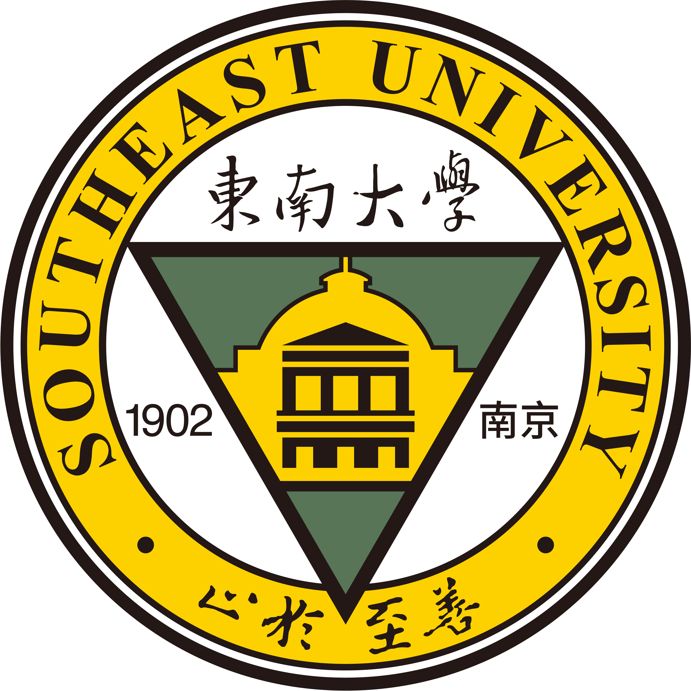

  

**AI Engineering** · Agent Systems

  <a href="https://xuxiaorui815.github.io/">&nbsp; Ruii’s Margins</a>
  &nbsp; · &nbsp;
  <a href="mailto:xiaorui.xu@antgroup.com">xiaorui.xu@antgroup.com</a>

## About me

<table>
<tr>
  <td width="300" valign="top"><b>Undergraduate student</b> &nbsp; <a href="https://www.seu.edu.cn/">Southeast University</a></td>
  <td width="130" valign="top">2023&#8288;–&#8288;2027</td>
</tr>
<tr>
  <td width="300" valign="top"><b>AI engineering intern</b> &nbsp; <a href="https://www.antgroup.com/">Ant Group</a></td>
  <td width="130" valign="top">2026&#8288;–&#8288;present</td>
</tr>
</table>

At **Ant Group**, I contribute to **DABAO（大保）**.

> DABAO connects AI agents with business workflows and supports continuous improvement through issue discovery, experimentation, evaluation, and feedback.

### Explore

[**Experience →**](pages/experience.md)  
Ant Group · DABAO · Agent infrastructure

[**Focus →**](pages/focus.md)  
AI interests and selected open-source projects
